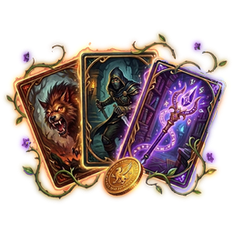

# Azeroth Almanac

A discovery addon for **WoW Forever**. It records what your characters meet in the world — creatures, items, quests, merchants, trainers, townsfolk, flight paths, zones, dungeons, herbs, veins and fishing waters — and turns it into an adventurer's journal that grows as you explore.

There are no completion percentages and no "x of y" totals. Progress is what you've found: running counts, research tiers per creature and node, milestones from your own discoveries, and a timeline of everything you've seen.

Nothing is shown before you've met it in your own game. No Wowhead or Questie data.

`/aa` opens it. Everything below is optional and switched on or off in `/aa settings`.

---

## The Almanac

| Page | What it holds |
|---|---|
| **Journal** | A timeline of discoveries by day, filtered by character, kind or zone, and the Overview: catalogue counts, research, milestones, recent finds, and who found what first |
| **Bestiary** | Creatures you've met: research tiers (Sighted → Fought → Studied → Mastered), abilities, loot, and kill and sighting spots on the map |
| **Items** | Everything looted, bought, received or carried, with where it came from |
| **Quests** | Quests offered and completed, objectives, rewards and givers |
| **Merchants** | Vendors visited, with their full stock and prices |
| **Trainers** | Class and profession trainers, spells and recipes as each character sees them |
| **Townsfolk** | Trainers, innkeepers, bankers, flight masters, vendors and quest givers — and every flight path your characters know |
| **Places** | Zones, the places within them and dungeons, with an in-page map |
| **Gathering** | Herbs, ore, chests, fishing and skinning by zone, with gathered and sighted spots on the world map and minimap |
| **Dungeons** | Dungeons and raids found, with bosses and loot as you meet them |
| **Characters** | Every character on the account: bags, bank, gear, auctions, professions and gold |

Records are account-wide. Every character adds to the same Almanac.

---

## For Fun

### Wild Gambit

**A creature card game played with your own Almanac.** Every creature you have slain is a card — seeing one is not enough, the first kill earns it — and the more you hunt a creature, the stronger its card becomes.

- **Your deck is what you've hunted.** A card's spikes come from the creature's level, its research tier, its home zone and its kind. Cards climb with you: Fought white, Hunted green, Master Hunter blue, Epic Hunter purple, Legendary Hunter orange.
- **Nine squares, two hands.** Place a card next to another and the higher spike on the touching side takes it. Whoever owns more cards when the board is full wins.
- **Pick a class for the round.** Each has one spell per match that removes, protects or swaps a card.
- **Play yourself.** Your own hero card grows stronger for every creature you bring to Master Hunter, and Hunters and Warlocks can bring their pet.
- **Play people.** Challenge another Almanac player, or practise against a wandering gambler. Beat someone and you earn *their* card; each person counts on their own, and they play harder as your card for them climbs.
- **Your collection.** Click the deck on the table to see every card you hold, five to a row, sorted and filtered, and star the five you want dealt to you more often.

### Murloc Tac Toe

Tic-tac-toe, Murlocs against Gnolls, against another player running Azeroth Almanac on your realm (or a connected one). Whoever challenges plays the Murlocs and moves first, and the sides swap on every rematch. Or practise against a gnoll.

### Gem Match

Match three or more Classic gems. Four in a row makes a power gem that clears a 3x3, five makes an Arcane Crystal that clears a whole colour. Timed (two minutes) or 30 Moves, mouse only, and it pauses by itself in combat.

### Wings & Whispers

Meet the creature carrying you on every flight: its name, its personality and a fun fact the first time, then how many times the two of you have flown together. A quip on landing, chat for your party if you want it, and an offer of a game of Gem Match on the longer flights.

---

## Quality of Life

Ported from Plus Everything, by the same author, and built on as the Almanac has grown.

### At the auction house

- **Auction prices** in item tooltips: the lowest price now and the seven-day average, from your own scans (one full scan every 15 minutes, or `/aa scan`).
- **Crafting profit** on the profession window: what the selected recipe costs to make against what the result sells for, after the auction house's cut, at both the current and the average price.
- **Disenchant values** in the tooltip of green, blue and purple armour and weapons.
- **One-key posting**: Alt+Right-click an item to load the whole stack into the sell frame at the lowest price known, then post it the same way.
- **Sales estimates** for the things you craft, worked out from what disappears between scans.

### Your gear, your bags, your other characters

- **Upgrade arrows** on items: green when it would be an upgrade for the character you're on, gold when it would be one for another of your characters and the copy you own isn't soulbound. Scored against what they wear and the talents they've taken.
- **Every character's bags, bank, gear, mail, auctions, professions and gold**, saved as you play them, searchable from one window (`/aa inv`).

### Finding your way

- **The navigation arrow**: a gold winged pointer at the top of the screen that turns to lead you to your map pin, or to the quest you've focused in the tracker — its turn-in once it's complete, otherwise the nearest place you've actually seen what it asks for. It works across a continent and tells you when it has nothing to point at.
- **Flight timers**: a countdown while you fly, learned from the flights you take, with estimates for routes you haven't flown yet. Boat and zeppelin schedules are learned by riding them, and times are shared with your guild and group, so one person riding a boat updates everyone.
- **Map pins** for the trainers, services, vendors and mailboxes you've met, and for every herb, vein and chest you've gathered or sighted.

### Questing and gathering

- **Quest targeter**: which mobs drop the quest item you still need, from your own Almanac and from what you learn by looting.
- **Gathering highlight**: a sparkle on the node you're facing, in the style and colour you choose.
- **Node tooltips that say where you stand**: hovering a herb, vein, pool or chest shows the skill it needs against your own, coloured the way the game colours gathering, and under it the node's rank, its badge, how many times you've gathered it and how many more to the next rank.
- **Tracker buttons** and **raid markers** on your quest tracker, and a ping on your target so your group can see where you're going.

### In a group

- **Follow button** on your target frame, which only appears on someone you can actually follow and greys out when they're too far away.
- **Healer Assist**: a clickable spell icon for each group member, lit when it fits their state and flashing on the best choice. For shamans, priests, druids, paladins and mages.
- **Threat monitor**: your threat on your target, a warning before you pull it off the tank, and coloured edges on enemy nameplates.
- **How far away a mob is, under its nameplate**. The game doesn't tell addons the distance to anything outside your party, so it's worked out from what the game will answer — whether a spell or an item would reach — and smoothed between those steps, so the number counts down as you walk in and settles when you stop. Everything with a nameplate, enemies only, or just your target.
- **Group nameplates and unit frames**, and **auto-invite** for anyone who asks with a keyword.

### Spells and talents

- **Spell ranks on your bars**: the game doesn't update your action bars when you train a new rank, so buttons still casting an old one glow gold with a green arrow. One button in your spellbook checks the lot, and shift-click updates them.
- **Talent Planner**: a tab on your Talents window. Plan any class at any level, save and follow builds, share talentsforever.com links, and stage a plan on your real talents before you apply it. The trees are read from the game, so they're WoW Forever's own.

### At the vendor

Repair on arrival (from guild funds first, if you like), grey junk sold, and the reward with the best vendor value marked at a quest turn-in. Each part has its own switch, and it says in chat what it did.

---

## Settings

`/aa settings`. Every helper above can be switched off, and each character picks a settings profile — Shared unless you choose another — so your alts don't have to match.

## Data

The Almanac ships hidden Classic records built from the VMaNGOS world database, and dungeon loot from AtlasLoot Revival, but a record only fills in once you've met the thing or earned the research tier that unlocks it.

Released under the GPL, version 2. The VMaNGOS and AtlasLoot Revival notices are in the addon's `Licenses` folder.
